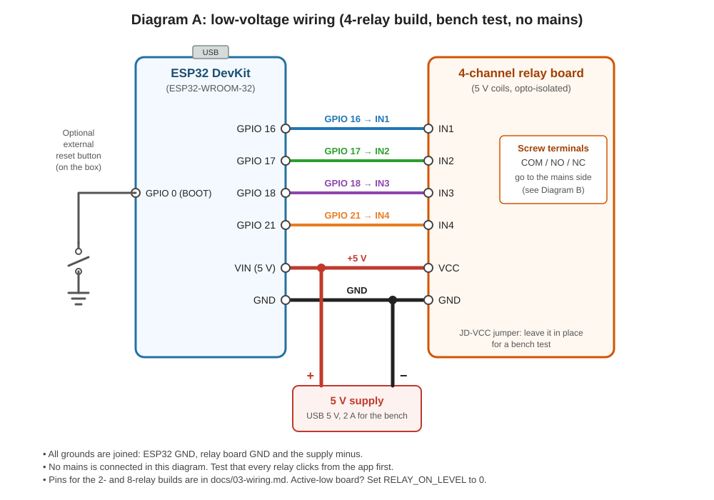
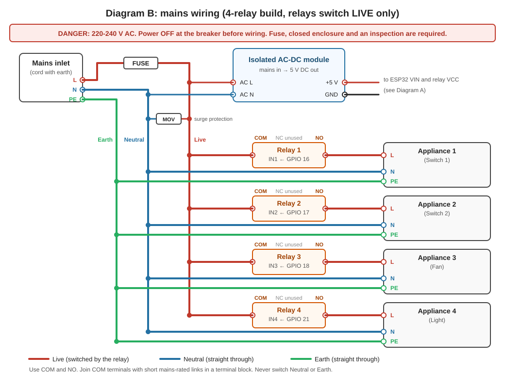

# 3. Wiring

Build and test the **low-voltage side first**, on a USB supply, with no mains
connected. Only move on to mains after every relay clicks correctly from the app.

### Diagram A: low-voltage wiring (4-relay build)



For the 2- and 8-relay builds the wiring is the same pattern: one GPIO to one
relay input, in the order given in the pin table below.

## 3.1 Low-voltage wiring (safe to bench-test)

### Pin table

| Relay | 2-relay build | 4-relay build | 8-relay build | Relay board pin |
|---|---|---|---|---|
| 1 | GPIO 16 | GPIO 16 | GPIO 16 | IN1 |
| 2 | GPIO 17 | GPIO 17 | GPIO 17 | IN2 |
| 3 | | GPIO 18 | GPIO 18 | IN3 |
| 4 | | GPIO 21 | GPIO 21 | IN4 |
| 5 | | | GPIO 22 | IN5 |
| 6 | | | GPIO 23 | IN6 |
| 7 | | | GPIO 25 | IN7 |
| 8 | | | GPIO 26 | IN8 |

### Power and ground

| From | To |
|---|---|
| 5 V supply (+) | Relay board `VCC` and ESP32 `VIN` / `5V` pin |
| 5 V supply (-) | Relay board `GND` and ESP32 `GND` (all grounds common) |

When flashing over USB the ESP32 gets power from the USB cable. If you also
connect a separate 5 V supply to `VIN`, do not connect both at once unless your
board has protection against it. Check your board's documentation.

### The JD-VCC jumper (if your relay board has one)

Some relay boards have three power pins: `VCC`, `JD-VCC` and `GND`, with a
jumper between `VCC` and `JD-VCC`.

- **Jumper in place:** relay coils and the input side share one supply. Simple, and fine for a bench test.
- **Jumper removed:** power `JD-VCC` from the 5 V supply and `VCC` from the ESP32's 3.3 V pin. This keeps the coil supply separate from the signal side. Read your board's documentation before doing this.

### Pins to avoid

| GPIO | Why |
|---|---|
| 0, 2, 12, 15 | Boot/strapping pins. Wrong levels at power-up can stop the board booting |
| 6 to 11 | Connected to the flash chip |
| 34 to 39 | Input only, cannot drive a relay |
| 19 | Left free because the stock example driver may use it |

### Reset button

The BOOT button on the dev board (GPIO 0) is already the reset button:

| Hold BOOT for | Result |
|---|---|
| about 3 seconds | Clears WiFi credentials and restarts into setup mode |
| about 10 seconds | Factory reset |

For a finished box, wire an external push-button between GPIO 0 and GND so it
can be reached from outside the enclosure. Do not press it during power-up.

## 3.2 Bench test (no mains)

1. Wire the pins as above and power from USB.
2. Flash the firmware ([04-build-and-flash.md](04-build-and-flash.md)).
3. Provision in the app ([05-app-setup-and-provisioning.md](05-app-setup-and-provisioning.md)).
4. Toggle each switch. The matching relay must click and its LED must light.
5. If everything is **backwards** (relay on when the app says off), your board is active-low. Set `RELAY_ON_LEVEL` to `0` in `relay_config.h`, rebuild and flash.

## 3.3 Mains wiring principle

### Diagram B: mains wiring (4-relay build)



PNG copies of both diagrams are in `docs/images/` if you want to print them.

A relay is a switch placed in the **Live** wire only. The control side (ESP32)
and the mains side only meet through the relay's coil.

```
Mains Live ──► fuse ──┬──► relay 1 COM        relay 1 NO ──► appliance 1 ──┐
                      ├──► relay 2 COM        relay 2 NO ──► appliance 2 ──┤
                      └──► (more relays)      ...                          │
                                                                           │
Mains Neutral ─────────────────────────────────────────────────────────────┴──► (all appliances)
Mains Earth   ─────────────────────────────────────────► appliance earth pins (never switched)
```

- Use **COM and NO** (normally open): the appliance is OFF by default and ON only when the relay is energised.
- Neutral and Earth go straight to the appliance, never through a relay.
- Join the COM terminals with short mains-rated links inside terminal blocks.
- The AC-DC module's input comes from Live (after the fuse) and Neutral. Its 5 V output feeds the low-voltage side described above.

**Before connecting mains, read [07-safety-and-installation.md](07-safety-and-installation.md).**
